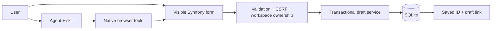

# Video Workspace — Symfony + WebMCP

A working example of a SaaS content workflow exposed to an AI agent through native browser WebMCP. Use the form yourself, or install the `video-add-content` skill and ask a compatible agent to prepare, save and verify an unpublished video draft.

**This is a Docker deployment package.** No hosted public demo is configured. Local execution and the native browser tool workflow have been verified; see [execution evidence](docs/native-verification.json).

Public source: [scheffershen/video-saas-webmcp-demo](https://github.com/scheffershen/video-saas-webmcp-demo).

## Run

Requires Docker with Compose. The image installs PHP 8.4, Symfony FrameworkBundle 7.4 LTS, SQLite and FFmpeg; no host PHP or paid API is required.

```sh
docker compose up -d --build
```

Open [Video Workspace locally](http://localhost:8094). Click **Start a demo workspace**, then **Add video content**. The Docker build generates an original eight-second test-pattern MP4. You can also upload an MP4 of up to 20 MiB through the normal file picker.

```sh
docker compose exec -T app vendor/bin/phpunit
node --test tests/webmcp.test.mjs
python -m unittest discover -s tests -p 'test_*.py'
docker compose exec -T app php bin/console app:cleanup
docker compose down
```

The named volume retains workspaces and uploads across restarts. `docker compose down` preserves it. Each workspace expires after 24 hours; cleanup runs on workspace creation and should also be scheduled hourly on a public host.

## Browser and agent setup

WebMCP is an experimental browser capability. For Chrome local testing, enable `chrome://flags/#enable-webmcp-testing` and relaunch, then use an agent client that can discover and execute native page tools. The agent must visit `/content/new` in the active workspace session. The page reports native registration status.

Verified on **Chrome 154.0.8037.93** using an isolated browser launched with `--enable-features=WebMCP --enable-blink-features=WebMCP`, driven by the Codex agent through Playwright. This preview required JSON-string arguments for native `executeTool`; an object failed on a read-only call before any mutation. Current Chrome documentation uses object arguments and deprecates strings from Chrome 155. Choose the encoding for the tested client/version before saving; never retry a save to experiment with encoding.

The built-in developer inspector calls the same implementations locally and labels its events **Inspector**. It is useful for development and works without native support, but it does not establish native agent discovery. There is no remote MCP endpoint and no universal browser/client compatibility claim.

Primary references: [Chrome overview](https://developer.chrome.com/docs/ai/webmcp), [imperative API](https://developer.chrome.com/docs/ai/webmcp/imperative-api), [implementation status](https://github.com/webmachinelearning/webmcp/blob/main/implementation-status.md).

## Install the agent skill

The distributable package is [skills/video-add-content](skills/video-add-content/SKILL.md). Copy that folder into your compatible agent's skills directory. For Codex on Windows, from this checkout:

```powershell
Copy-Item -LiteralPath .\skills\video-add-content -Destination "$env:USERPROFILE\.codex\skills\video-add-content" -Recurse
```

Start a fresh agent session so the installed skill is discovered. The skill supplies workflow instructions; your browser/client still needs native WebMCP access. It contains no credentials.

For full media preparation, install Python 3.10+, FFmpeg/ffprobe and `pip install -r skills/video-add-content/scripts/requirements.txt` in the agent's Python environment. The helper transcribes locally using an open Whisper model and extracts a real cover frame. The agent translates timed cues into EN/FR/DE/IT/ES and drafts the title/description; the helper validates and writes five VTT files. The first run downloads the selected model. No SaaS-side AI keys are required. Review generated captions and metadata before publishing elsewhere. Silent videos require a real supplied transcript.

The form includes a cover image upload (PNG/JPEG/WebP, 3 MiB), five separate VTT uploads (1 MiB each), title, description/content, category, source language, date and MP4 selection. Upload files before typing metadata, because the normal upload forms reload the page. Attachments are optional for a basic draft; the full skill workflow attaches all six. A VTT must contain ordered plain cues within the video duration; STYLE/REGION blocks and cue settings are not supported.

Example prompt:

> Use $video-add-content on http://localhost:8094/content/new in my current workspace. Select the sample video. Create a draft titled “Welcome to Video Workspace”, with the summary “A short introduction to adding video content.” Use Getting Started, English, and October 3, 2026. Save it and give me the draft link.

Full workflow prompt (supply an actual local path):

> Use $video-add-content with my local MP4 and the current workspace. Transcribe its speech, extract a cover, generate EN/FR/DE/IT/ES VTT files, and write a factual title and description. Use Training, the video's source language, and October 3, 2026. Upload everything, save an unpublished draft, and return its verified link.

[Full workflow evidence](docs/full-workflow-verification.json) records native execution with one actual cover and five actual generated captions. The saved detail page exposed five subtitle tracks and matching download links.

Required facts missing from a request are resolved with the user. Choices and owned asset IDs come from the app, and duration comes from server inspection. The skill never publishes content.

## How it works



| Tool | Purpose |
|---|---|
| `get_video_content_form_state` | Read values, choices, accessible assets and save state |
| `prepare_video_content_draft` | Validate and atomically update visible metadata without saving |
| `save_video_content_draft` | Save the prepared revision using the existing CSRF-protected form |
| `get_video_content_draft` | Read persisted proof by draft ID or reconcile by save key |

Both save paths use `VideoFormType`, `VideoInput`, and `DraftService`. A unique `(workspace_id, save_key)` and a SQLite transaction make identical retries return one record; changed metadata with that key conflicts. Edits invalidate browser preparation. A lost POST response stays uncertain until authenticated readback completes.

Session-scoped temporary workspaces are a demonstration tenancy model. Limits: five MP4 uploads, thirty attachments, twenty drafts, 24-hour expiry, 256 MiB of combined uploaded media, bounded active workspaces and request rates. MP4 uploads are inspected with ffprobe; images and caption cues are validated. Files are stored outside `public/`, with generated names. Media and draft reads require the owning workspace. Drafts reject attachments for another video, workspace, type or language. No publish/delete/billing tools are exposed.

## Deploy

See [the Docker deployment guide](docs/deployment.md). Use HTTPS and persistent storage. Replace the demo-session entry point with real authentication and permissions when adapting this pattern to a production SaaS. GitHub Pages cannot execute this PHP backend.

## Tutorial

[Download the 4:58 tutorial and publishing package](https://github.com/scheffershen/video-saas-webmcp-demo/releases/tag/v1.0.0). The release includes a 1080p MP4, English SRT/VTT captions, thumbnail, and editable chapter source with narration audio.

[Written walkthrough](docs/tutorial.md), [narration sources](tutorial/audio-scripts), and [video source notes](tutorial/README.md) explain the actual manual and native save paths. Large generated media stays outside Git. The application is packaged for Docker; public app hosting is deferred.

## Source layout

`src/Workspace` owns session isolation and storage limits. `src/Video` owns media and draft operations. `src/Controller` exposes the visible workflow. `public/webmcp.js` registers native tools; `public/draft-session.js` handles revisions and uncertain saves. `skills/video-add-content` is the installable instruction package.

MIT licensed application code. Bundled Source Sans 3 and Source Code Pro fonts retain their SIL Open Font License notices. The sample media is generated from FFmpeg test sources. This standalone project contains no Medflixs source, history, branding or content.

See [third-party notices](THIRD_PARTY_NOTICES.md) for the tutorial runtime and dependency licenses.
